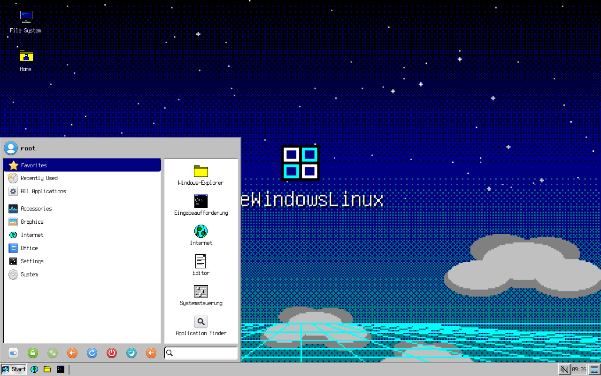
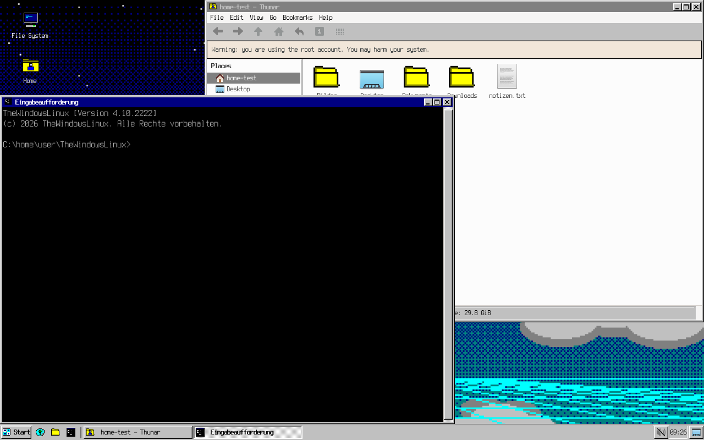
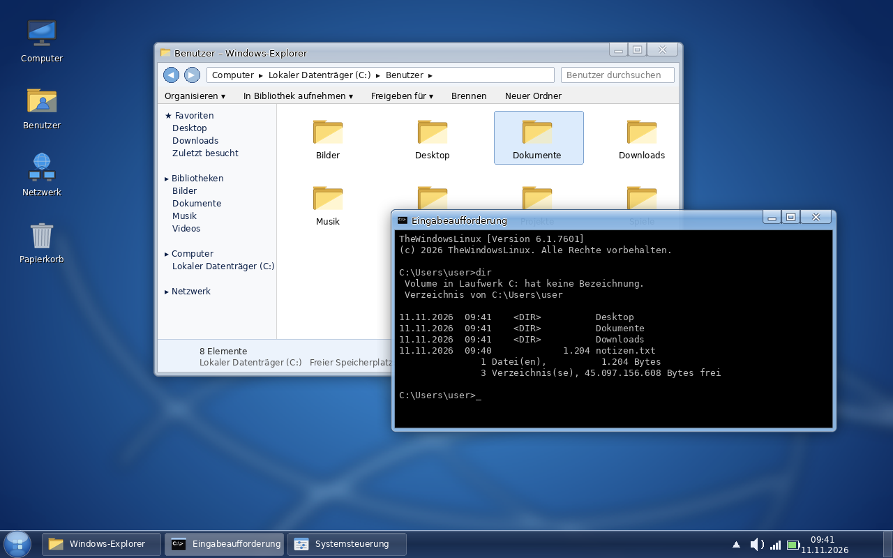

# TheWindowsLinux

[](https://github.com/DementedBrick/TheWindowsLinux/actions/workflows/checks.yml)

> **Entwicklungsstand:** Das Projekt entwickelt sich vom XFCE-Overlay zu einem eigenständigen Linux-System. Installer und experimentelle ISO-Builds sind vorhanden; vor einem stabilen Image stehen noch vollständige Installations- und Hardwaretests an. Details stehen unter [Live-ISO](#live-iso) und in der [Checkliste für ein erstes öffentliches Image](docs/PUBLIC_RELEASE.md).

**Ein normales Linux mit komplettem Windows-Overlay – wahlweise im Pixel-Retro-Look
(Windows-95-Ära, wie in alten Desktop-Spielen) oder im Windows-7-Aero-Look – plus
einer „Eingabeaufforderung“, die sich wie `cmd.exe` verhält.**

Unter der Haube bleibt es ein ganz gewöhnliches Linux (Debian, Ubuntu, Mint, Fedora,
Arch, openSUSE, Void …) mit XFCE. TheWindowsLinux legt darüber:

* **Retro-Stil (Standard):** 16-Farben-VGA-Palette, Dithering, pixelgenaue
  Win95-Fensterrahmen, Pixel-Icons, Pixel-Mauszeiger, Pixel-Schrift (Terminus),
  kein Antialiasing, Chiptune-Systemklänge, gedithertes Wallpaper mit Sternenhimmel
  und Cyber-Raster.
* **Aero-Stil:** Glas-Fensterrahmen, Start-Orb, Swirl-Wallpaper, Windows-7-Taskleiste.
* **Terminal-Overlay „Eingabeaufforderung“:** `C:\Users\name>`-Prompt, `DIR`, `CLS`,
  `COPY`, `DEL`, `TYPE`, `IPCONFIG`, `TASKLIST`, `SYSTEMINFO`, `SHUTDOWN /s`, …
  Windows-Pfade mit Backslash funktionieren. Alle Linux-Befehle bleiben verfügbar.

Echte XFCE-Screenshots des Retro-Stils (unter Xvfb aufgenommen):




Der Aero-Stil als Entwurf (`docs/preview-aero.png`):



Alle Grafiken, Icons, Cursor und Klänge sind **eigene Arbeiten** (erzeugt von
`tools/generate-assets.py`). Es sind keine Microsoft-Dateien enthalten.

---

## Installation

```bash
git clone https://github.com/DementedBrick/TheWindowsLinux.git
cd TheWindowsLinux
./install.sh                    # Retro-Stil, nur für den aktuellen Benutzer
```

Danach **abmelden und mit der Sitzung „Xfce“ neu anmelden** (oder neu starten).

Weitere Varianten:

```bash
./install.sh --style aero                   # Windows-7-Aero-Look statt Retro
sudo ./install.sh --system --with-login     # für alle Benutzer + Anmeldebildschirm
sudo ./install.sh --full                    # alles: System, Login, GRUB, Plymouth, cmd überall
./install.sh --no-packages                  # XFCE ist schon da, nur Overlay anwenden
./install.sh --cmd-everywhere               # jedes Terminal wird zur Eingabeaufforderung
sudo ./install.sh --system --harden         # System absichern (Firewall, Auto-Updates, Kernel, SSH)
./install.sh --help                         # alle Optionen
```

Der Installer

1. installiert die Pakete (XFCE, Whisker-Menü, Thunar, xfce4-terminal, Schriften,
   Cursor; auf einem nackten System auch Xorg + LightDM),
2. kopiert Theme, Icons, Hintergründe und Sounds,
3. schreibt die XFCE-Konfiguration (Taskleiste, Startmenü, Desktop-Symbole,
   Fensterverwaltung, Tastenkürzel, Thunar, Benachrichtigungen),
4. richtet das cmd-Overlay ein,
5. optional: LightDM-Greeter, GRUB-Hintergrund, Plymouth-Boot-Splash.

Läuft bereits eine XFCE-Sitzung, wird sie sofort aktualisiert. Vorhandene eigene
Konfigurationsdateien werden beim ersten Installieren gesichert (`~/.config/thewindowslinux/original/`
bzw. `/var/lib/thewindowslinux/original/`) und bei der Deinstallation wiederhergestellt.

**Deinstallation:** `./uninstall.sh` (bzw. `sudo ./uninstall.sh --system`) stellt den Zustand vor der
Installation wieder her – getestet bis aufs Byte, auch für Installationen älterer Versionen.
Installierte Pakete und die Firewall bleiben bestehen.

**Systemmodus (`--system`) und bestehende Benutzer:** Dateien, die die Distribution selbst mitliefert
(z. B. die Sitzungsdefinition von XFCE), werden in `/etc/xdg` nie überschrieben. Neue Benutzer bekommen die volle
Konfiguration aus `/etc/skel`; bestehende Benutzer erhalten beim nächsten Login Theme, Schrift und Hintergrund
(win7-firstrun). Für Panel-Layout und Tastenkürzel eines bestehenden Benutzers dort `./install.sh` (ohne `--system`) ausführen.
**Stil wechseln:** `./install.sh --style aero --no-packages` (oder `--style retro`).

### Unterstützte Systeme

| Distribution | Paketschritt |
|---|---|
| Debian, Ubuntu, Mint, Pop!_OS, Zorin, Raspberry Pi OS | `apt` |
| Fedora, RHEL/Rocky/Alma | `dnf` |
| Arch, Manjaro, EndeavourOS | `pacman` |
| openSUSE | `zypper` |
| Void | `xbps` |
| andere | `--no-packages` + XFCE 4.14+ von Hand installieren |

Getestet mit XFCE 4.18 (Ubuntu 24.04). Benötigt werden `xfce4-panel`, `xfwm4`,
`xfdesktop`, `xfce4-session`, `xfconf`, `thunar`, `xfce4-terminal` und das
`xfce4-whiskermenu-plugin`.

---

## Bedienung

| Aktion | Tastenkürzel |
|---|---|
| Startmenü | **Win** (oder Alt+F1) |
| Windows-Explorer (Thunar) | **Win+E** |
| Ausführen… | **Win+R** |
| Desktop anzeigen | **Win+D** |
| Sperren | **Win+L** |
| Eingabeaufforderung | **Strg+Alt+T** / Win+T |
| Task-Manager | **Strg+Umschalt+Esc** / Strg+Alt+Entf |
| Systemsteuerung | Win+I |
| Fenster andocken (Aero Snap) | **Win+←/→/↑/↓** |
| Fenster wechseln | Alt+Tab |
| Screenshot | Druck / Alt+Druck (Fenster) |
| Lupe | Win+Plus / Win+Minus |

Im Startmenü (Whisker-Menü) liegen „Windows-Explorer“, „Eingabeaufforderung“,
„Systemsteuerung“, „Editor“, „Task-Manager“ und „Ausführen…“ als Favoriten.
Rechtsklick in Thunar bietet „Eingabeaufforderung hier öffnen“.

**Alles größer** (Taskleiste, Icons, Startmenü, Schrift, Fensterrahmen, Mauszeiger, Eingabeaufforderung):

```bash
win7-scale 150        # 100, 125, 150, 175 oder 200 – wirkt sofort und bleibt gespeichert
win7-scale reset      # zurück auf 100 %
./install.sh --scale 150   # gleich bei der Installation (mit --system: Vorgabe für neue Benutzer)
```

Ab 150 % werden doppelt große Fensterrahmen genutzt; die Pixel-Icons wachsen in ganzen Vielfachen und bleiben scharf.
In Thunar vergrößert **Strg + Plus** zusätzlich die Datei-Symbole.

Hintergrund wechseln: `win7-wallpaper list` zeigt alle Bilder (sunset, matrix, sky, hills,
pattern, planet, teal, …), `win7-wallpaper set sunset` setzt eines, `win7-wallpaper random`
würfelt, und `win7-wallpaper ~/Bilder/foto.png` nimmt ein eigenes Bild.

Sounds abschalten: `win7-sound --off` (wieder an: `win7-sound --on`) oder den
Autostart-Eintrag „Anmeldesound“ in den Sitzungseinstellungen deaktivieren.

---

## Die Eingabeaufforderung (cmd-Overlay)

```
TheWindowsLinux [Version 4.10.2222]
(c) 2026 TheWindowsLinux. Alle Rechte vorbehalten.

C:\Users\user>dir
 Volume in Laufwerk C: hat keine Bezeichnung.

 Verzeichnis von C:\Users\user

11.11.2026  09:41    <DIR>          .
11.11.2026  09:41    <DIR>          ..
11.11.2026  09:41    <DIR>          Dokumente
11.11.2026  09:40             1.204 notizen.txt
               1 Datei(en),          1.204 Bytes
               3 Verzeichnis(se), 45.097.156.608 Bytes frei

C:\Users\user>copy notizen.txt Dokumente\kopie.txt
        1 Datei(en) kopiert.
```

Das Overlay ist eine `bash`-Schicht (`cmd/cmdrc.sh`): Es definiert Funktionen und
Aliase, übersetzt Windows-Pfade (`C:\Users\…`, `..\x`, `%USERPROFILE%`) transparent
und fängt Tippfehler mit der Windows-Fehlermeldung ab. Groß-/Kleinschreibung ist egal
(`DIR` = `dir`), `.exe` wird ignoriert, Tab-Vervollständigung ignoriert die Schreibweise.

Start: Menüeintrag **Eingabeaufforderung**, Strg+Alt+T, oder in jedem Terminal `cmd`.
`cmd /c BEFEHL` führt einen Befehl aus; `cmd /k BEFEHL` lässt die Shell offen.
`bash` oder `wsl` startet eine normale Linux-Shell; mit `--cmd-everywhere` ist das
Overlay in jeder bash aktiv.

| Windows-Befehl | macht |
|---|---|
| `dir [/b /w /s /a]`, `cd`, `cd..`, `cd\`, `md`, `rd /s`, `del /q`, `copy`, `xcopy`, `robocopy`, `move`, `ren`, `type`, `more`, `tree /f`, `attrib`, `mklink`, `fc`/`comp`, `find`, `findstr`, `where` | Datei-Operationen (mit Windows-Ausgabeformat) |
| `cls`, `ver`, `vol`, `date`, `time`, `pause`, `title`, `color 0A`, `echo.`, `rem`, `set`, `set /p`, `set /a`, `path`, `timeout /t`, `choice`, `help` | Konsole |
| `ipconfig [/all /flushdns]`, `getmac`, `ping [-t -n]`, `tracert`, `netstat`, `nslookup`, `net user/start/stop/view/use` | Netzwerk |
| `tasklist`, `taskkill /pid n /f`, `taskkill /im name`, `systeminfo`, `winver`, `sc query`, `chkdsk`, `diskpart`, `certutil -hashfile`, `assoc` | System |
| `shutdown /s /r /l /h /a /t n`, `logoff` | Herunterfahren / Neustart / Abmelden |
| `explorer`, `notepad`, `wordpad`, `calc`, `mspaint`, `control`, `taskmgr`, `msconfig`, `regedit`, `snippingtool`, `iexplore`, `wmplayer`, `start …` | startet das passende Linux-Programm |

`format` ist absichtlich deaktiviert.

---

## Absichern und prüfen

**`win7-doctor`** prüft das laufende System auf typische Lücken – rein lesend, mit `sudo` gründlicher:

```
== 2. Updates ==
[WARN] 19 Sicherheitsupdates stehen aus (25 Updates insgesamt).
       ↳ sudo apt update && sudo apt upgrade
== 3. Firewall und offene Ports ==
[WARN] Keine aktive Firewall gefunden.
       ↳ sudo ./install.sh --system --harden
```

Geprüft werden: Overlay-Dateirechte, ausstehende Sicherheitsupdates, Firewall, von außen erreichbare Ports, SSH-Konfiguration,
Konten (leere Passwörter, UID 0, sudo ohne Passwort), automatische Anmeldung, riskante Dienste, schreibbare PATH-Ordner,
SUID-Dateien an ungewöhnlichen Orten – und der **Linux-Kernel**: läuft der neueste installierte Kernel, steht ein Kernel-Update aus,
CPU-Schwachstellen (Spectre, Meltdown, MDS …), abgeschaltete Schutzfunktionen in den Startparametern, Kernel-Einstellungen
(ASLR, BPF, perf, Null-Zeiger-Schutz, Symlink-Schutz …), Secure Boot, Festplattenverschlüsselung, AppArmor/SELinux sowie bekannte
Schwachstellen (CVE) über die Werkzeuge der Distribution (`ubuntu-security-status`, `debsecan`, `arch-audit`, `dnf updateinfo`).
Eine Lücke im Kernel selbst behebt nur ein Kernel-Update der Distribution mit Neustart. Rückgabewert = Anzahl der Warnungen (`--fast` überspringt die langsamen Suchen).

**`--harden`** (mit `--system`) behebt die häufigsten Befunde: Firewall (`ufw`, eingehend gesperrt – laufendes SSH bleibt erreichbar),
automatische Sicherheitsupdates, Kernel-/Netzwerk-Einstellungen (`/etc/sysctl.d/99-thewindowslinux.conf`) und SSH-Härtung.
Wer Pentest-Labs mit eingehenden Verbindungen betreibt, gibt Ports gezielt frei (`sudo ufw allow 4444/tcp`).

Der vollständige Prüfbericht zu diesem Projekt (gefundene und behobene Lücken) steht in [docs/AUDIT.md](docs/AUDIT.md).
Sicherheitslücken bitte vertraulich melden; Hinweise dazu stehen in [SECURITY.md](.github/SECURITY.md).

---

## Tests

Die Standardprüfungen laufen bei jedem Push und Pull Request automatisch über GitHub Actions. Der Systemmodus-Test wird dort nicht ausgeführt, weil er Systemdateien verändert; dafür weiterhin eine Wegwerf-VM oder einen Container verwenden.

```bash
bash tests/run-all.sh             # Lint + Overlay-Tests + Installations-Roundtrip + Altversions-Deinstallation
sudo bash tests/test-system.sh    # Systemmodus (verändert das System – nur in Wegwerf-Container/VM)
```

* `tests/test-cmd.py` startet die Eingabeaufforderung in einem echten Pseudo-Terminal (mit der Ubuntu-Standard-`.bashrc`)
  und prüft, dass Windows-Befehle funktionieren **und** normale Linux-Befehle (`mkdir -p`, `find -exec … \;`, `cd -`, `echo -e`,
  `ping`, `time` …) unverändert bleiben.
* `tests/test-doctor.sh` baut Kernel-Zustände nach (gut und schlecht) und prüft, dass `win7-doctor` offene CPU-Schwachstellen,
  abgeschaltete Schutzfunktionen, einen älteren laufenden Kernel und bekannte Schwachstellen erkennt.
* `tests/test-install.sh` installiert zweimal (Retro, dann Aero) auf einem Testkonto mit eigenen Konfigurationsdateien,
  deinstalliert und vergleicht den Zustand Datei für Datei.
* `tests/test-system.sh` installiert systemweit aus einem Quellordner mit fremdem Eigentümer, startet eine echte
  XFCE-Sitzung für einen neuen Benutzer und deinstalliert wieder.

---

## Aufbau des Repositories

```
install.sh / uninstall.sh      Installer / Deinstaller (Benutzer- oder Systemmodus)
lib/common.sh                  Hilfsfunktionen, Distributions- und Stil-Erkennung
scripts/                       Installationsschritte: packages, theme, xfce, cmd, login
cmd/cmdrc.sh                   das cmd-Overlay für bash
cmd/bin/                       cmd, win7-terminal, win7-sound, win7-wallpaper, win7-doctor, win7-firstrun
theme/styles/retro/            Retro-Stil: gtk/Windows-Retro, xfwm4, icons (+cursors), wallpapers, sounds
theme/styles/aero/             Aero-Stil: gtk/Windows7-Aero, xfwm4, icons, wallpapers, sounds
theme/xfce4/                   XFCE-Konfiguration (xfconf-Kanäle, Panel, Starter, Terminal, Thunar, Autostart)
tools/generate-assets.py       erzeugt alle Grafiken/Sounds neu (PIL + numpy, Cursor via xcursorgen)
iso/build-iso.sh               Live-ISO mit Debian live-build (Overlay vorinstalliert)
scripts/harden.sh              optionaler Schritt: Absicherung
tests/                         automatische Tests (Overlay, Installation, Systemmodus)
docs/AUDIT.md                  Prüfbericht
docs/                          Screenshot und Mockups
```

### Assets neu erzeugen / anpassen

```bash
pip install pillow numpy            # falls nötig; xcursorgen aus x11-apps für die Cursor
python3 tools/generate-assets.py            # beide Stile
python3 tools/generate-assets.py --style retro --only icons
```

Die Pixel-Icons und -Cursor sind als Text-Sprites in `tools/generate-assets.py`
definiert (`RETRO_SPRITES16`, `CURSOR_SPRITES`) und lassen sich dort direkt
bearbeiten; die 32-px-Icons werden mit Zeichenprimitiven gemalt.

### Live-ISO

`sudo ./iso/build-iso.sh --style retro` baut mit Debian `live-build` ein bootfähiges
ISO (XFCE + Overlay systemweit + Calamares-Installer). Benötigt einen Debian/Ubuntu-Host
mit `live-build debootstrap xorriso squashfs-tools`, Internet und ~10 GB Platz.
Der ISO-Build wurde in der Entwicklungsumgebung nur auf Syntax geprüft, nicht komplett
durchlaufen. Das Live-System meldet sich als `user` mit dem Passwort `live` an (Standard von Debian
live-config) – bei einer Installation sofort ändern. 

---

## Bekannte Grenzen

* Nur die mitgelieferten Icons (Start, Computer, Papierkorb, Netzwerk, Ordner,
  Eingabeaufforderung, Systemsteuerung, Browser, Editor, Task-Manager, Ausführen) sind
  Pixel-Art; alle anderen Programm-Icons kommen aus dem geerbten Icon-Theme
  (elementary-xfce/Adwaita).
* Der Retro-Stil schaltet das Font-Antialiasing systemweit ab (gewollt). Rückgängig:
  Einstellungen → Erscheinungsbild → Schriften, oder `--style aero`.
* Qt-Programme nehmen den GTK-Look nur an, wenn `qt5-gtk2-platformtheme`
  (bzw. `qt5-styleplugins`) installiert ist.
* Wayland-Sitzungen werden nicht unterstützt (XFCE/X11). GTK-4-/libadwaita-Programme (z. B. neuere GNOME-Apps)
  ignorieren GTK-3-Themes und behalten ihr eigenes Aussehen.
* Die Eingabeaufforderung ist eine bash-Schicht, keine Windows-Emulation: Windows-Befehle heißen und
  funktionieren ähnlich (`DIR`, `COPY`, `IPCONFIG`, …), Windows-Programme (`.exe`) laufen dadurch nicht.
  Normale Linux-Befehle bleiben unverändert (siehe Tests). `cd` ohne Argument zeigt wie unter Windows das
  aktuelle Verzeichnis an (Home: `cd ~`); `shutdown` nutzt die Windows-Schalter `/s /r /l /h /a`, Linux-Aufrufe
  wie `shutdown -h now` gehen unverändert an das echte Programm.
* Das Overlay bringt keine Programme mit, sondern nur Konfiguration und Grafiken: Sicherheitslücken (CVEs) in den
  installierten Programmen kommen aus der Distribution – darum regelmäßig aktualisieren (`--harden` richtet
  automatische Sicherheitsupdates ein).
* Nicht in der Entwicklungsumgebung ausgeführt (nur Syntax/Vorbereitung geprüft): GRUB-/Plymouth-/LightDM-Schritte
  auf echter Hardware und der komplette ISO-Bau.

## Lizenz

MIT – siehe [LICENSE](LICENSE). „Windows“ ist eine Marke der Microsoft Corporation;
dieses Projekt steht in keiner Verbindung zu Microsoft.
